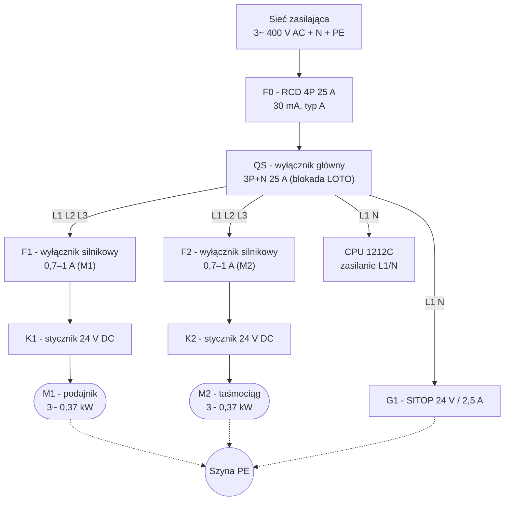
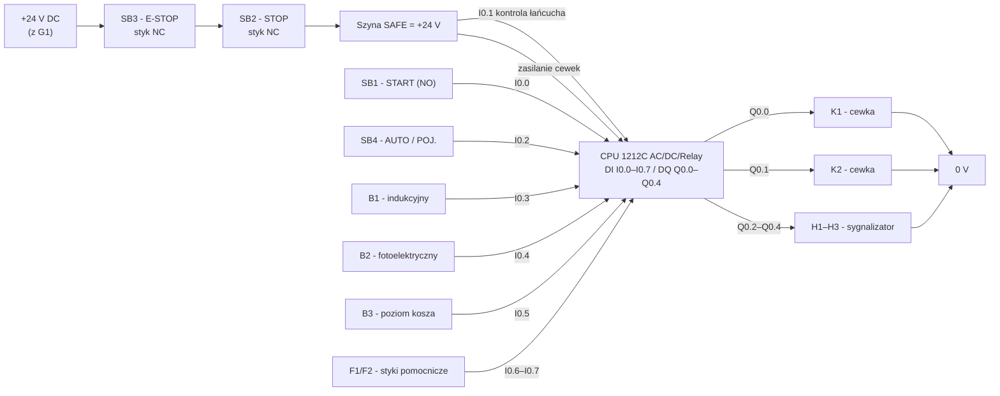

# Stanowisko sterowane jednym PLC

## Wybrany wariant 0 lub 9
---

## 1. Opis działania stanowiska

### 1.1 Funkcja

Elementy (np. walcowe detale metalowe) leżą luzem w koszu zasypowym. Zadaniem stanowiska jest **pojedynczo podawać je na taśmociąg** i transportować do strefy odbioru. Jednym sterownikiem PLC realizowane są: sterowanie podajnikiem wibracyjnym (M1), sterowaniem taśmociągu (M2), obsługa czujników, sygnalizacja oraz obsługa łańcucha bezpieczeństwa (E-STOP).

### 1.2 Cykl pracy (algorytm)

1. **GOTOWOŚĆ** - po załączeniu wyłącznika głównego i zasilacza PLC sprawdza warunki startu:
   - E-STOP zwolniony i łańcuch bezpieczeństwa „zdrowy” (I0.1 = 1),
   - brak zadziałania wyłączników silnikowych F1/F2,
   - kosz nie jest pusty (B3 = 1),
   - taśmociąg pusty (B2 = 0).
   Zielona lampka H1 pulsuje - stan gotowości.
2. **START** - naciśnięcie SB1 (I0.0). H1 świeci światłem ciągłym, zostaje załączony stycznik K1 → rusza **podajnik M1**. Detale przesuwają się w kierunku krawędzi taśmociągu.
3. **PODANIE DETALU** - czujnik indukcyjny B1 (I0.3) wykrywa detal opuszczający podajnik. PLC wyłącza M1 (K1) i załącza taśmociąg M2 (K2).
4. **TRANSPORT** - detal jedzie po taśmie do czujnika fotoelektrycznego B2 (I0.4) na końcu przenośnika.
5. **ZRZUT** - po wykryciu detalu przez B2 PLC odlicza czas T = 1 s (dojazd do krawędzi) i zatrzymuje M2. Detal spada do pojemnika odbiorczego.
6. **POWTÓRZENIE** - w trybie **AUTO** cykl powtarza się automatycznie po 2 s przerwy. W trybie **POJEDYNCZY** (SB4) stanowisko czeka na kolejne naciśnięcie START.

### 1.3 Zatrzymania i usterki

| Zdarzenie | Reakcja |
|---|---|
| SB2 STOP | natychmiastowe zatrzymanie M1 i M2, powrót do GOTOWOŚCI |
| SB3 E-STOP | odcięcie napięcia cewek styczników (łańcuch bezpieczeństwa, kategoria zatrzymania 0) + czerwona lampka H2 |
| Przeciążenie F1/F2 | blokada pracy, H2 miga, wymagane skasowanie usterki |
| Brak detali w koszu (B3 = 0) | koniec pracy, żółta lampka H3, oczekiwanie na uzupełnienie kosza |
| Zanik napięcia | po powrocie zasilania stanowisko NIE startuje samoczynnie (wymagany START) |

Kasowanie usterki: usunięcie przyczyny → zwolnienie grzybka E-STOP → RESET (ponowne naciśnięcie START).

---

## 2. Lista elementów

| Lp. | Element | Typ / symbol katalogowy | Ilość | Link |
|----|---------|--------------------------|-------|------|
| 1 | Sterownik PLC | Siemens SIMATIC S7-1200 **CPU 1212C AC/DC/Relay**, 6ES7212-1BE40-0XB0 (8 DI, 6 DQ przekaźnikowych, zasilanie 230 V AC) | 1 | https://mall.industry.siemens.com/mall/en/WW/Catalog/Product/6ES7212-1BE40-0XB0 |
| 2 | Zasilacz 24 V DC | Siemens **SITOP PSU100C 24 V / 2,5 A**, 6EP1332-1SH42 | 1 | https://mall.industry.siemens.com/mall/en/WW/Catalog/Product/6EP1332-1SH42 |
| 3 | Wyłącznik silnikowy (podajnik) | Siemens **3RV1011-1JA10**, zakres 0,7–1 A | 1 | https://mall.industry.siemens.com/mall/en/WW/Catalog/Product/3RV1011-1JA10 |
| 4 | Wyłącznik silnikowy (taśmociąg) | Siemens **3RV1011-1JA10**, zakres 0,7–1 A | 1 | https://mall.industry.siemens.com/mall/en/WW/Catalog/Product/3RV1011-1JA10 |
| 5 | Stycznik (podajnik) | Siemens **3RT2015-1BB41**, cewka 24 V DC, 3 kW / 400 V | 1 | https://mall.industry.siemens.com/mall/en/WW/Catalog/Product/3RT2015-1BB41 |
| 6 | Stycznik (taśmociąg) | Siemens **3RT2015-1BB41**, cewka 24 V DC | 1 | https://mall.industry.siemens.com/mall/en/WW/Catalog/Product/3RT2015-1BB41 |
| 7 | Silnik przekładniowy podajnika | Motoreduktor 3~ 0,37 kW, 230/400 V, np. **SEW-EURODRIVE R37 DRN63M4** | 1 | https://www.sew-eurodrive.pl/produkty/ |
| 8 | Silnik przekładniowy taśmociągu | Motoreduktor 3~ 0,37 kW, 230/400 V (j.w.) + bęben napędowy | 1 | https://www.sew-eurodrive.pl/produkty/ |
| 9 | Podajnik wibracyjny / kosz zasypowy | Podajnik wibracyjny rynnowy 300 mm z napędem mimośrodowym | 1 | https://www.tme.eu/pl/katalog/?search=podajnik+wibracyjny |
| 10 | Czujnik indukcyjny B1 | **IFM IFS204** - M12, PNP NO, zasięg 4 mm, 10–30 V DC | 1 | https://www.ifm.com/pl/pl/product/IFS204 |
| 11 | Czujnik fotoelektryczny B2 | **SICK WL4S-3P2230** - reflektoryjny, PNP, 24 V DC | 1 | https://www.tme.eu/pl/katalog/?search=WL4S-3P2230 |
| 12 | Czujnik poziomu B3 | Czujnik pojemnościowy M18, PNP NO, 24 V DC (kontrola napełnienia kosza) | 1 | https://www.tme.eu/pl/katalog/?search=czujnik+pojemnosciowy+M18+PNP |
| 13 | Przycisk START | Schneider **Harmony XB4BA31** - zielony, zestyk NO | 1 | https://www.se.com/pl/pl/product/XB4BA31/ |
| 14 | Przycisk STOP | Schneider **Harmony XB4BA42** - czerwony, zestyk NC | 1 | https://www.se.com/pl/pl/product/XB4BA42/ |
| 15 | Wyłącznik awaryjny E-STOP | Schneider **XB4BS8445** - grzybek Ø40, zatrzaskowy, 1 NC (+ dokładany zestyk XB4BZ102) | 1 | https://www.se.com/pl/pl/product/XB4BS8445/ |
| 16 | Przełącznik trybu pracy | Przełącznik krzywkowy 2-pozycyjny, zestyk NO (AUTO / POJEDYNCZY) | 1 | https://www.tme.eu/pl/katalog/?search=przelacznik+krzywkowy+2+poz |
| 17 | Wyłącznik różnicowoprądowy F0 | 4P, 25 A, **30 mA**, typ A | 1 | https://www.tme.eu/pl/katalog/?search=roznicowka+4P+25A+30mA |
| 18 | Wyłącznik główny QS | Krzywkowy 3P+N, 25 A, z możliwością zablokowania kłódką (LOTO) | 1 | https://www.tme.eu/pl/katalog/?search=wlacznik+glowny+3P%2BN+25A |
| 19 | Sygnalizator kolumnowy | Wieża sygnalizacyjna 24 V DC, 3 moduły (zielony / żółty / czerwony) | 1 | https://www.tme.eu/pl/katalog/?search=wieza+sygnalizacyjna+24V |
| 20 | Szafa sterownicza | Obudowa naścienna IP54, 600×600×250 mm, z płytą montażową | 1 | https://www.tme.eu/pl/katalog/?search=szafa+sterownicza+IP54 |
| 21 | Osprzęt | Listwy zaciskowe, dławiki, przewody LgY/LiY, korytka, oznaczniki, wyłącznik nadprądowy 2 A (F3) | 1 kpl. | - |

> Uwaga: dla pozycji oznaczonych linkiem do wyszukiwarki wystarczy wpisać podany symbol katalogowy - ceny i dostępność zmieniają się w czasie. Dopuszczalne są równoważne zamienniki innych producentów (Eaton, Schneider, Omron, Phoenix Contact) o tych samych parametrach.

---

## 3. Schemat elektryczny

### 3.1 Obwód siłowy (400 V AC)

### 3.2 Obwód sterowania i łańcuch bezpieczeństwa (24 V DC)

**Zasada działania obwodu bezpieczeństwa:** styki NC E-STOP i STOP są połączone **szeregowo, na sztywno (hardwired)** i tworzą szynę `SAFE`, z której zasilane są cewki styczników K1/K2 (poprzez wyjścia przekaźnikowe PLC) oraz wejście kontrolne I0.1. Dzięki temu naciśnięcie E-STOP **bezpośrednio odcina cewki styczników**, niezależnie od stanu programu i ewentualnej awarii PLC. Stan szyny jest jednocześnie czytany przez PLC (sygnalizacja i blokada startu).

### 3.3 Tabela wejść / wyjść PLC

| Adres | Symbol | Element | Funkcja |
|---|---|---|---|
| I0.0 | SB1 | przycisk START (NO) | start cyklu / kasowanie usterki |
| I0.1 | SAFE | łańcuch E-STOP + STOP | kontrola stanu bezpieczeństwa |
| I0.2 | SB4 | przełącznik trybu | 0 = pojedynczy cykl, 1 = AUTO |
| I0.3 | B1 | czujnik indukcyjny | detal podany z podajnika |
| I0.4 | B2 | czujnik fotoelektryczny | detal na końcu taśmociągu (zrzut) |
| I0.5 | B3 | czujnik pojemnościowy | kosz napełniony |
| I0.6 | F1 | styk pomocniczy | przeciążenie podajnika |
| I0.7 | F2 | styk pomocniczy | przeciążenie taśmociągu |
| Q0.0 | K1 | stycznik | załączenie podajnika M1 |
| Q0.1 | K2 | stycznik | załączenie taśmociągu M2 |
| Q0.2 | H1 | lampka zielona | gotowość / praca |
| Q0.3 | H2 | lampka czerwona | awaria / E-STOP |
| Q0.4 | H3 | lampka żółta | brak elementów w koszu |

Wykorzystano 8 wejść i 5 wyjść - mieści się w CPU 1212C (8 DI / 6 DQ) bez modułów rozszerzeń, co dodatkowo upraszcza i potania stanowisko.

